# 🏡 StudentNest

**StudentNest** is a native desktop marketplace built with **JavaFX 21** designed for students of **Daffodil International University (DIU)** in Ashulia, Bangladesh. It connects students looking for hostels, flats, and shared seats directly with local house owners — without relying on external websites, brokers, or social media guesswork.

---

## 📸 App Screenshots (v4 Latest)

### ☀️ Light Theme Overview

| Home Overview | Browse & Search Properties |
| :---: | :---: |
| 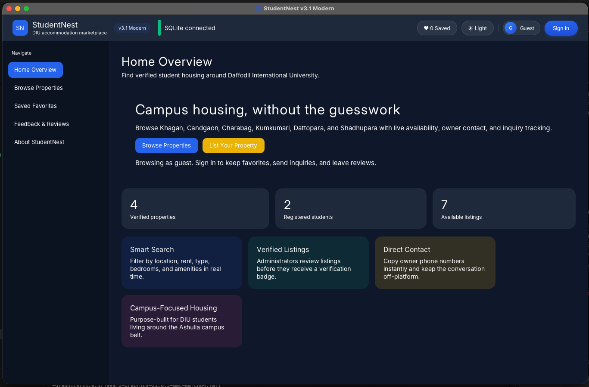 | 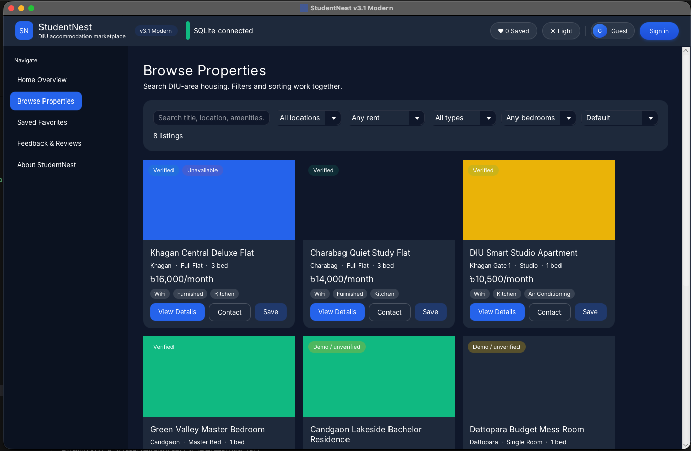 |

| Saved Favorites | Student Portal |
| :---: | :---: |
| 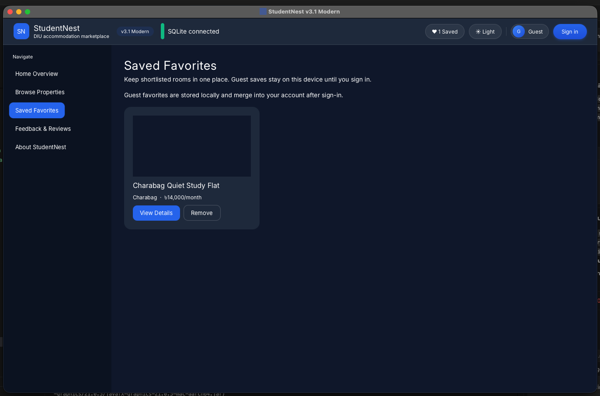 | 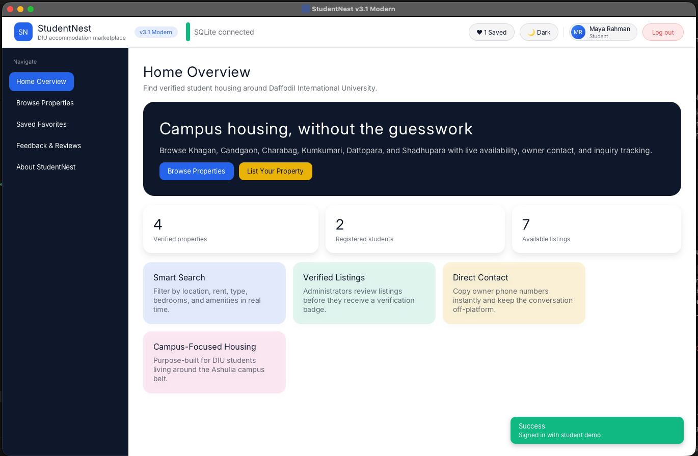 |

| Community Reviews | Campus Guide & Tips |
| :---: | :---: |
| 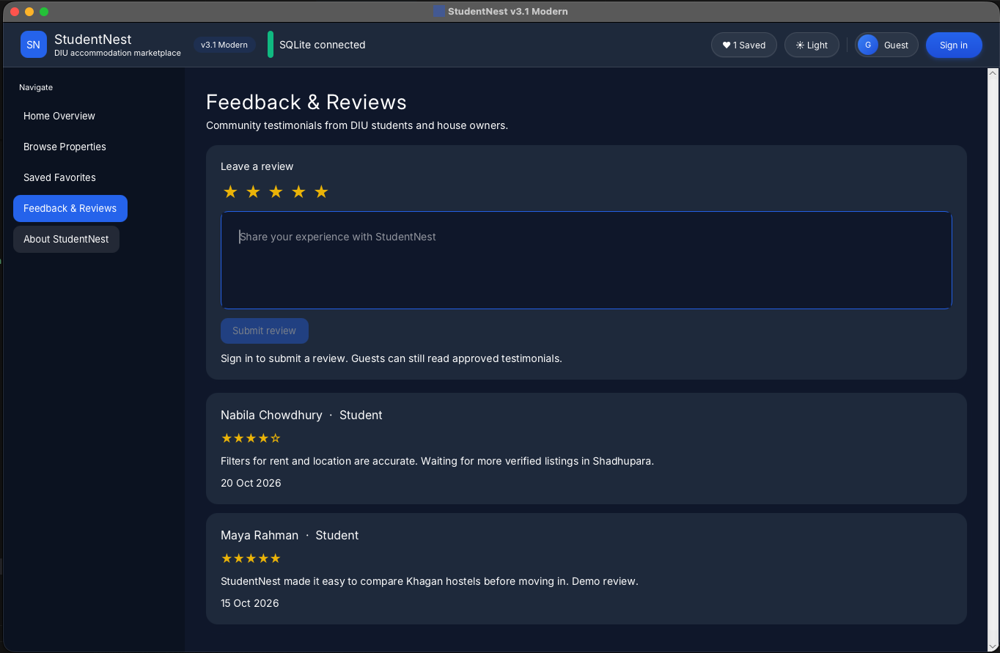 | 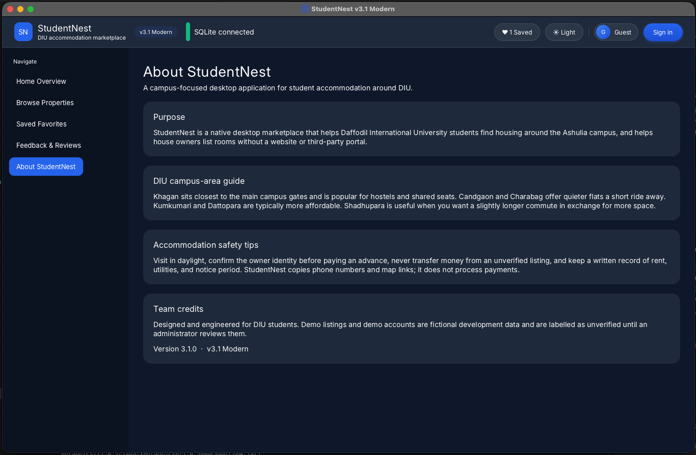 |

---

### 🌙 Dark Theme & Dashboards

| Admin Analytics Dashboard (Live KPIs & Charts) | Admin Listing Moderation |
| :---: | :---: |
| 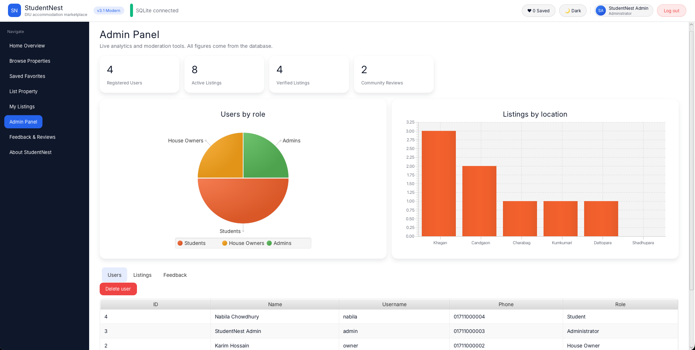 | 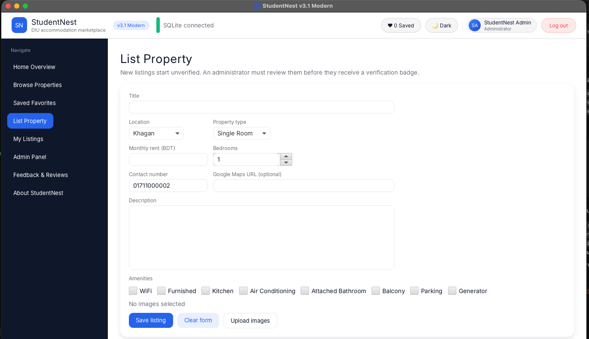 |

| House Owner Management Portal | Dark Mode Campus Guide |
| :---: | :---: |
| 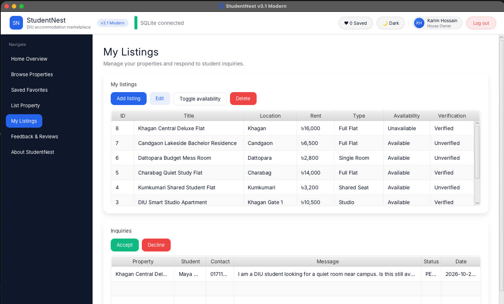 | 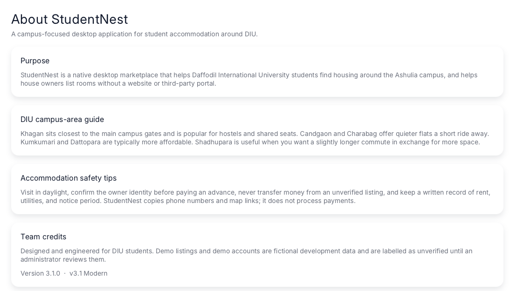 |

---

### 🔐 Dialogs & Modals

| Sign In (1-Click Demos) | Account Registration | Sleek Dark Sign Out Modal |
| :---: | :---: | :---: |
| 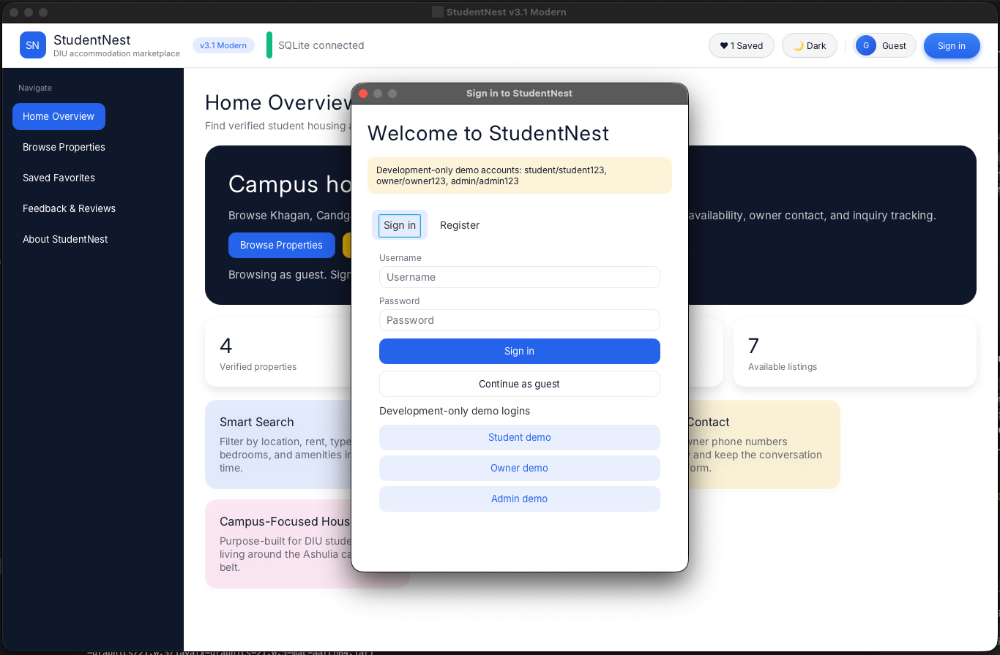 | 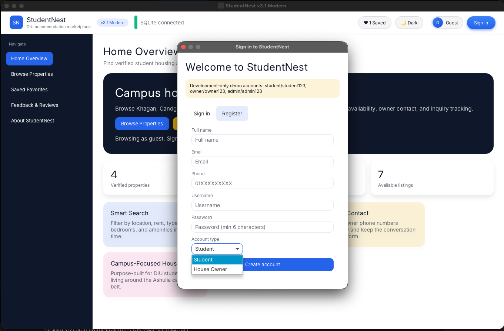 | 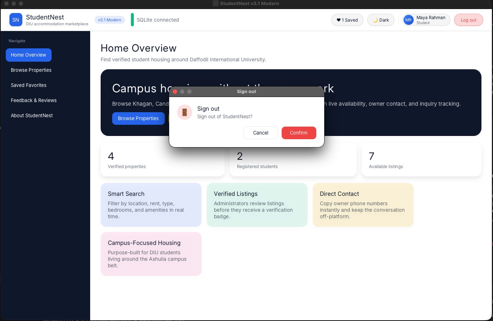 |

---

### 🎯 Smart Multi-Filter Dropdowns

| Location | Rent Range | Room Type | Bedrooms | Sort |
| :---: | :---: | :---: | :---: | :---: |
| 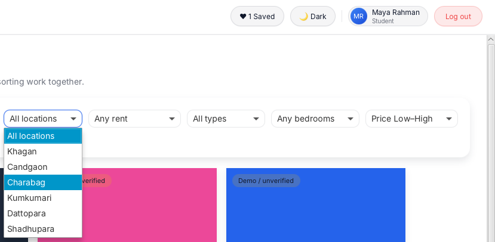 | 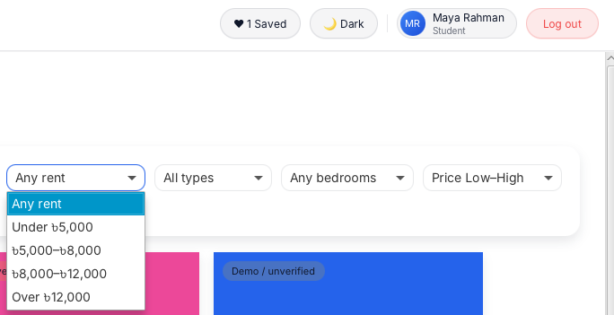 | 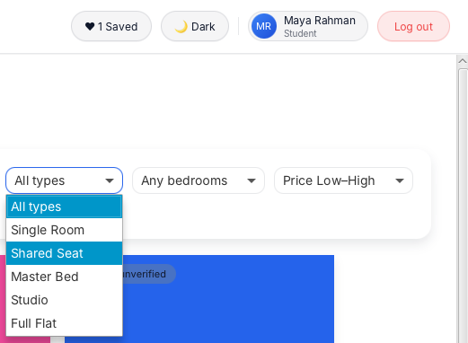 | 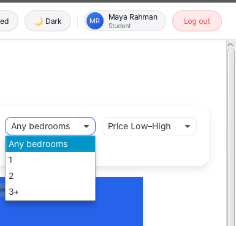 | 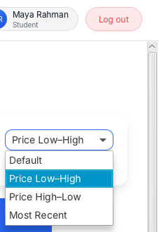 |

---

## ⚡ What StudentNest Does

StudentNest streamlines accommodation discovery around the DIU Ashulia campus with dedicated tools for all user roles:

1. **Smart Housing Search & Multi-Filters**:
   - Filter by **Location** (*Khagan, Candgaon, Charabag, Kumkumari, Dattopara, Shadhupara*).
   - Filter by **Rent Range** (*Under ৳5,000*, *৳5,000–৳8,000*, *৳8,000–৳12,000*, *Over ৳12,000*).
   - Filter by **Room Type** (*Single Room, Shared Seat, Master Bed, Studio, Full Flat*) and **Bedrooms** (*1, 2, 3+*).
   - Sort instantly by price (low to high, high to low) or most recent listings.

2. **Direct Contact & Verified Safety**:
   - One-click copy owner phone number.
   - One-click open Google Maps search location.
   - Verified property badges prevent fraud and unverified listings are flagged until reviewed.

3. **Shortlist & Saved Favorites**:
   - Bookmark rooms as a guest without creating an account.
   - Guest saves are stored locally and automatically merge into your account upon sign-in.

4. **House Owner Property Management**:
   - Add, edit, and delete accommodation listings.
   - Upload room photos stored in `room_images/`.
   - Toggle availability status (*Available / Unavailable*) in real time.
   - Track and respond to student inquiries (*Accepted / Declined*).

5. **Administrator Moderation & Analytics**:
   - Real-time KPI cards (*Total Registered Users, Active Listings, Verified Listings*).
   - Live interactive charts: **Users by Role (Pie Chart)** and **Room Types Distribution (Bar Chart)**.
   - Verify, unverify, or remove listings to keep the marketplace safe.

6. **Dual Database Engine (Zero Config)**:
   - **SQLite (Default fallback)**: Automatically creates `studentnest.db` with sample demo listings on first launch. No external database server required.
   - **MySQL (Optional)**: Automatically connects to local MySQL (port 3306) if available, with seamless automatic fallback to SQLite.

7. **Adaptive Themes & Polished UI**:
   - Full Light and Dark mode support with persistent user preferences saved in `~/.studentnest/prefs.properties`.

---

## 🚀 Quick Start (Running v4)

For detailed step-by-step instructions on Windows, macOS, and Linux, see **[run.md](run.md)**.

### Prerequisites
- **JDK 21 LTS** installed (`java -version`)
- Maven Wrapper included (no separate Maven install required)

### 🪟 Windows
```cmd
cd v4
mvnw.cmd javafx:run
```

### 🍎 macOS / 🐧 Linux
```bash
cd v4
chmod +x mvnw
./mvnw javafx:run
```

### 🔑 Demo Accounts (Auto-Seeded)
| Role | Username | Password |
|---|---|---|
| **Student** | `student` | `student123` |
| **House Owner** | `owner` | `owner123` |
| **Administrator** | `admin` | `admin123` |
| **Guest** | *(None)* | Click **Continue as guest** |

---

## 👥 Contributors

We proudly present our dedicated team behind **StudentNest**:

| Name | GitHub Profile |
|---|---|
| **Md. Arman Hossen Ripon** | [@armanhossen-dev](https://github.com/armanhossen-dev) |
| **Sabbir Hosine** | [@sabbir-hossine](https://github.com/sabbir-hossine) |
| **Md. Hasibur Rahman** | [@Hasib55-bit](https://github.com/Hasib55-bit) |
| **Md. Rahul Hossain** | [@Rahul003-phy](https://github.com/Rahul003-phy) |
| **Md. Wahidur Rahman** | [@Saief24](https://github.com/Saief24) |
